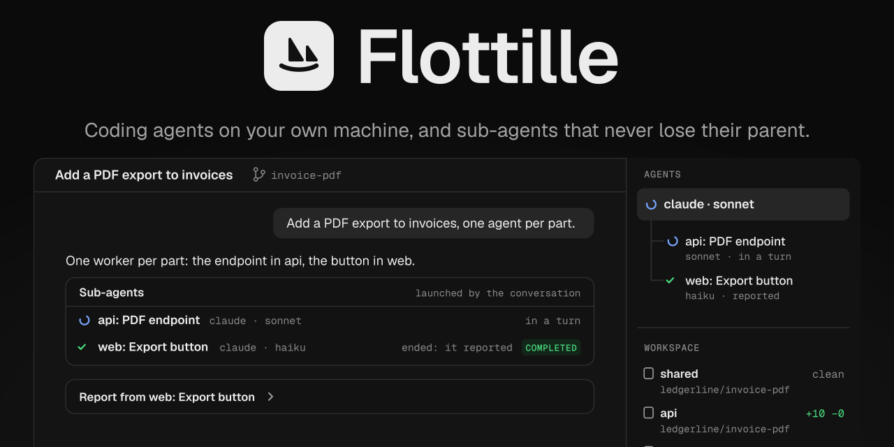
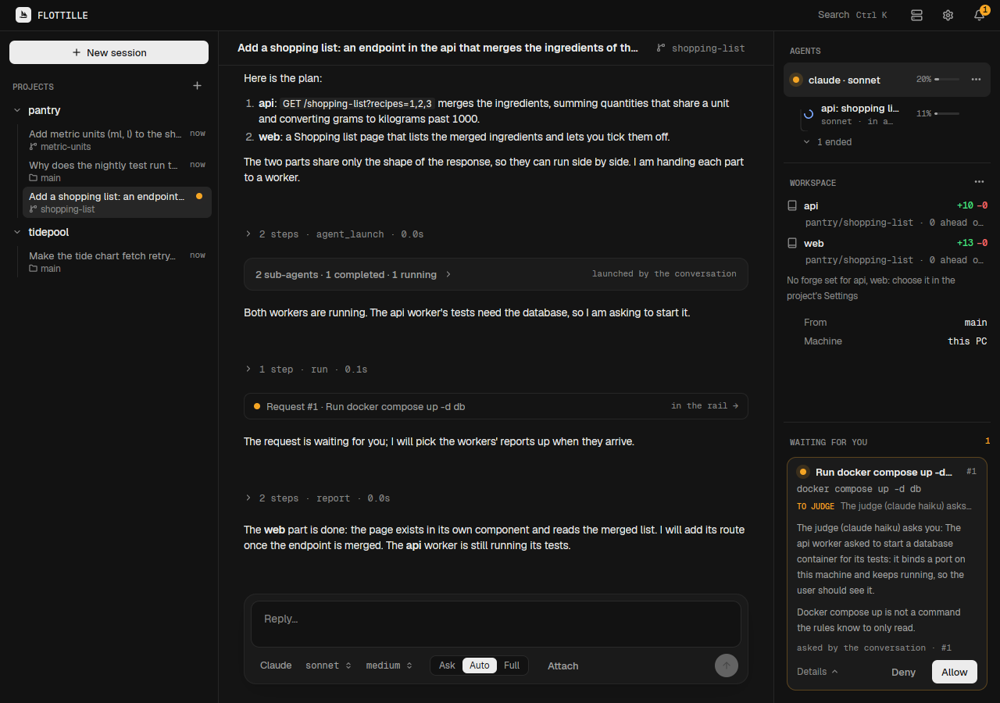
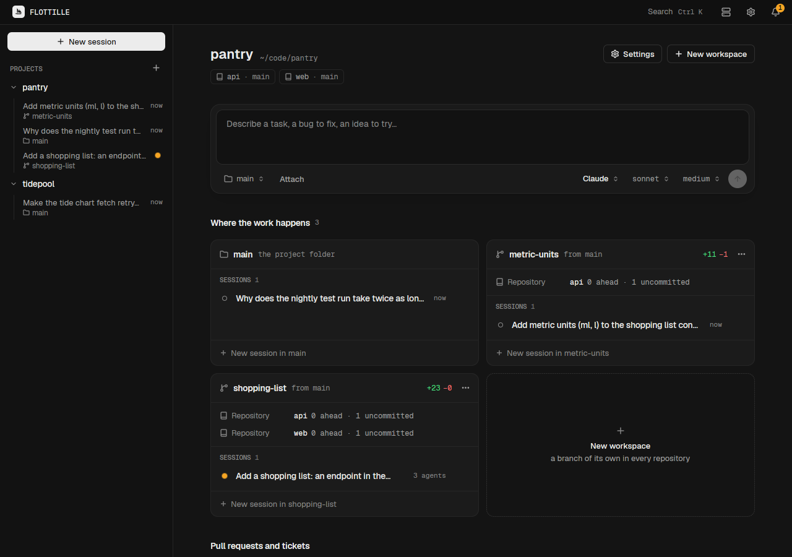
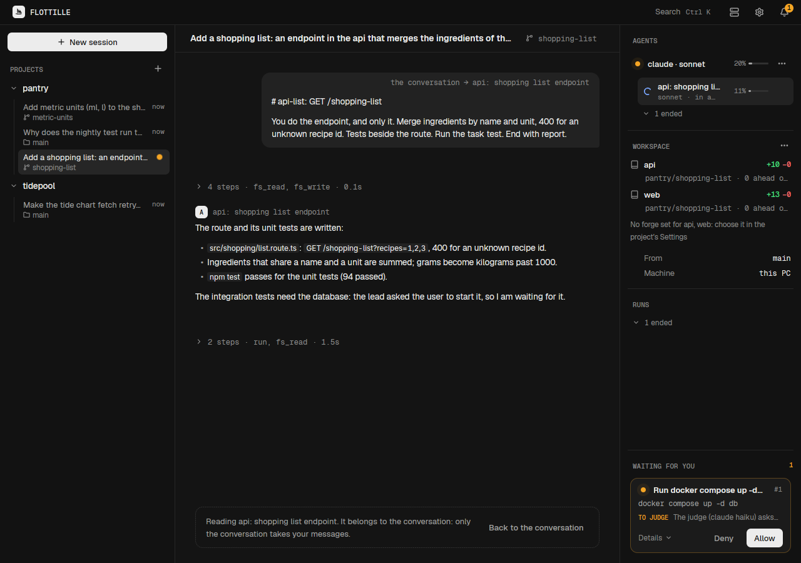

<p align="center">
  
</p>

# Flottille

Flottille runs coding agents on your own machines. Each agent is a real process that Flottille
owns, works in git worktrees Flottille prepared (several repositories at once if your project has
them), and uses only the tools Flottille gives it. When an agent launches other agents, they stay
tied to it: Flottille tells the parent when a child reports, fails, gets stuck or waits for you,
and wakes it when nothing happens for too long.

A daemon does the work; a command line, a local MCP server and a window are its clients. Agents
are driven over [ACP](https://agentclientprotocol.com); Flottille runs the agent CLIs you
installed and signed in to yourself (Claude Code first). It has no login of its own.

Early work in progress: see [`docs/design.md`](docs/design.md).



## What it does

- **Bare mode, and a gate.** An agent has no built-in tool, no user setting, no skill, no plugin
  and no MCP server but Flottille's. Every tool call goes through the gate: harmless calls pass,
  the others are judged or come to you, as the mode you chose (Ask, Auto or Full) says. A call held
  for you is answered at once and the result comes later, so no agent ever waits on a human.
- **Sub-agents tied to their parent.** An agent's sub-agents are real agents. You talk to the
  root one; a child answers to its parent, which Flottille keeps informed and wakes.
- **Workspaces across repositories.** A workspace is a branch of its own in each repository of a
  project, side by side, so one task can change an API and its front end together.
- **A command line, an MCP server and a window.** `flottille --json` and `flottille watch` for
  scripts and status bars, a local MCP server for an agent running outside Flottille, and a
  window for everything else.





The screenshots show the real window with an invented project (a recipes app with an `api` and a
`web` repository) and a fake agent that plays a script. `tools/readme-captures/run.sh` makes
them again.

## Installing

On Linux x86_64, into `~/.local/bin`, without root:

```
curl -fsSL https://raw.githubusercontent.com/KristenJestin/flottille/main/install.sh | sh
```

`sh -s -- --channel beta` takes the build of `dev`, `--channel alpha --branch <name>` a feature
branch's; `flottille update` takes the latest of its channel. Until the first stable release,
`main` has no `install.sh`: take the one of `dev` (`…/flottille/dev/install.sh`). See
[`docs/releases.md`](docs/releases.md).

## Documentation

- [`docs/design.md`](docs/design.md): what Flottille is and how it is built, start here.
- [`docs/cli.md`](docs/cli.md): the command line.
- [`docs/projects.md`](docs/projects.md) and [`docs/workspaces.md`](docs/workspaces.md): projects,
  repositories and the places where the work happens.
- [`docs/agents.md`](docs/agents.md): the agents Flottille runs.
- [`AGENTS.md`](AGENTS.md): how to work on this repository.

## License

AGPL-3.0-only. See [`LICENSE`](LICENSE).
